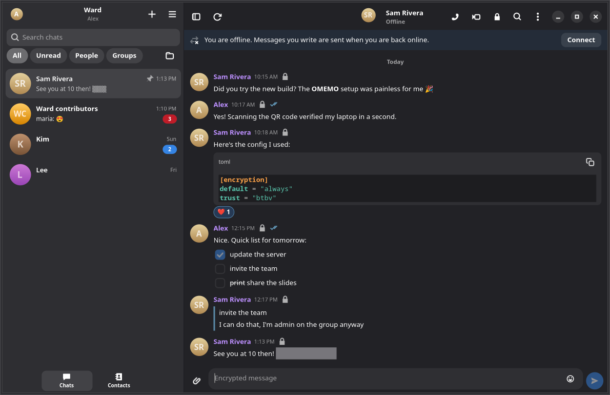
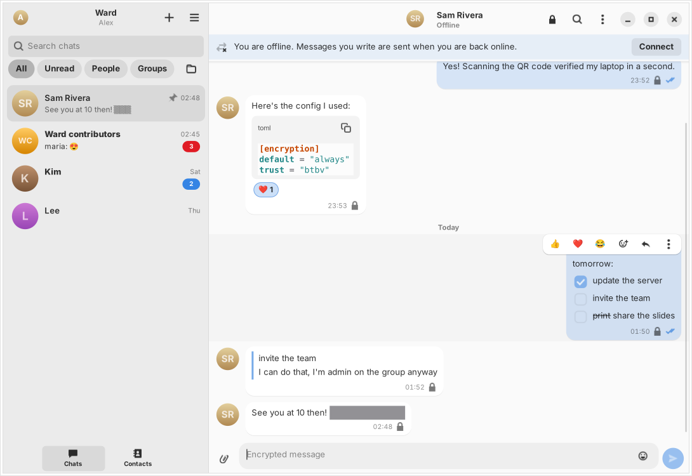
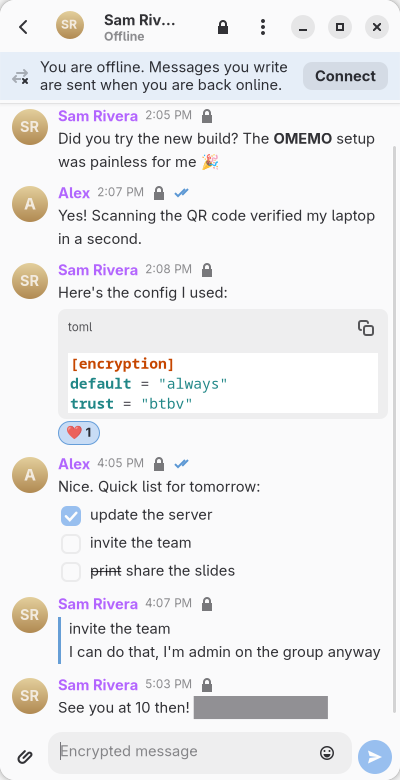

# Ward v1.0.0

**Private messaging on the open XMPP network, for Linux and the BSDs.**

Ward is a modern XMPP (Jabber) client built with GTK 4 and libadwaita. Chats are end-to-end encrypted with OMEMO
by default, messages are written in Markdown, and it works with Conversations, Monal, Dino, Gajim and every other
XMPP app, on any server, including your own. It aims to replace Gajim without losing anything Gajim users rely on.


| | |
| --- | --- |
|  |  |
|  |  |

<p align="center"></p>

## Features

- **Encrypted by default.** OMEMO 2 (with Stanza Content Encryption) and legacy OMEMO side by side, so you can talk
  to today's apps and tomorrow's. Blind trust before verification or manual trust, fingerprints in the format
  Conversations and Gajim show, QR codes and verification links, new-device banners, a lock and trust state on every
  message, and trust export to move to a new computer. Encrypted groups for members-only rooms.
- **OpenPGP, optional.** XEP-0373/0374 for chats with Gajim's OpenPGP users. Ward shares the GnuPG keyring that
  [GPGMan](https://github.com/Smiley-McSmiles/GPGMan) manages: pick a key you made there, or import a key file
  GPGMan exported.
- **Rich messages.** Markdown rendered into native widgets: code with syntax highlighting, tables, quotes, lists and
  task lists, spoilers, mentions and emoji. Messages from other apps get the standard XMPP styling, so `*this*` still
  means what they meant.
- **Everything a messenger should do.** Replies, reactions, edits with history, delete for everyone, delivery and
  read receipts synced across your devices, typing notifications, drafts, files and images (encrypted when the chat
  is), full-text search, message requests from strangers, blocking and spam reports.
- **Groups and channels.** Private groups and public channels with sensible presets, invites, a members panel,
  roles and moderation, group settings, bookmarks with autojoin and public channel search.
- **Note to self**, a chat with your own address that reaches all your devices (account menu > Note to self).
- **Several accounts**, with a colour each, certificate pinning for self-hosted servers, proxies and Tor, and account
  creation right from the app (with the server's form and CAPTCHA) or from an invite link.
- **For server admins and developers.** Native pages for every ad-hoc command your server offers, invite links,
  an XML console and a service discovery browser.
- **A good desktop citizen.** Adaptive from phones to wide screens, notifications that update instead of piling up,
  background mode, an unread badge, an optional tray icon, `xmpp:` links from your browser, deep and searchable
  preferences.

## Install

Ward runs on any Linux distribution and on FreeBSD, OpenBSD, NetBSD and DragonFly BSD with **Python 3.11+, GTK 4.12+
and libadwaita 1.4+**. Download from the [releases page](https://github.com/smiley-mcsmiles/ward/releases):

| System | How |
| --- | --- |
| Any Linux with Flatpak | `flatpak install --user ward-1.0.0.flatpak` (everything included) |
| Debian 13+, Ubuntu 24.04+, Mint 22+, Pop!_OS | `sudo apt install ./ward_1.0.0_all.deb` |
| Fedora 40+, RHEL 10, openSUSE | `sudo dnf install ./ward-1.0.0-1.noarch.rpm` (`zypper install` on openSUSE) |
| Arch, Manjaro, EndeavourOS | `sudo pacman -U ward-1.0.0-1-any.pkg.tar.xz`, or the PKGBUILD from `recipes.tar.gz` |
| Void | `xbps-install -R . ward` from a `./package.sh void` build, or the template in the recipes |
| Alpine, postmarketOS | the APKBUILD in the recipes (`abuild -r`) |
| Gentoo | the ebuild in the recipes, in a local overlay |
| FreeBSD | the port in the recipes (`net-im/ward`), or `sudo sh install.sh --install-deps` |
| OpenBSD | the port in the recipes (`net/ward`), or `doas sh install.sh --install-deps --vendor` |
| NetBSD | the pkgsrc package in the recipes (`chat/ward`), or `sudo sh install.sh --install-deps --vendor` |
| Anything else | the tarball: `sudo ./install.sh` (or `./install.sh --prefix ~/.local` without root) |

`install.sh` is plain POSIX sh. Useful options:

```sh
sudo ./install.sh --install-deps   # dependencies with apt, dnf, zypper, pacman, xbps, apk, emerge, pkg, pkg_add or pkgin
./install.sh --check               # what is missing on this machine, and the command to install it
./install.sh --vendor              # also fetch Python libraries your system has no packages for
sudo ./install.sh --uninstall      # your chats and settings in ~/.config/ward and ~/.local/share/ward stay
```

`ward --check` prints the same report from an installed Ward.

### Encryption libraries

The OMEMO libraries ([python-omemo](https://github.com/Syndace/python-omemo), twomemo, oldmemo, x3dh, doubleratchet
and xeddsa) are not in most distributions or in the BSD ports trees yet. The Flatpak includes them. With the other
packages, Ward offers to download them the first time you write an encrypted message (also under Preferences >
Encryption): they go into `~/.local/share/ward/python`, nothing else on your system changes, and Ward restarts to use
them. `install.sh --vendor` does the same for every user of the machine.

Legacy OMEMO (oldmemo), which most apps still use, is licensed under the AGPL-3.0; Ward itself is MIT. You can leave it
out, and talk OMEMO 2 only.

### Optional extras

GtkSourceView 5 (code highlighting), libspelling (spell check), libsecret (passwords in the system keyring), GnuPG
(OpenPGP), Pillow (smaller images), linkify-it-py (better link detection) and the GStreamer media
plugins (video and audio). `ward --check` lists what you have.

## Running in the background, systemd and runit

Closing the window keeps Ward connected (Preferences > General); **Ctrl+Q** or Quit stops it completely, including
the background part. "Start at login" uses XDG autostart, which works with any init system. If you prefer a
supervised service, both are installed and optional:

```sh
systemctl --user enable --now ward                               # systemd
mkdir -p ~/.config/service && cp -r /usr/share/ward/runit ~/.config/service/ward   # runit (Void, with turnstile)
```

Quitting from the app is respected by both: systemd only restarts Ward after a crash, and under runit Ward marks its
service down before exiting. Nothing in Ward depends on systemd (sleep and resume are noticed through logind or
elogind when either is there).

### Memory

While Ward runs in the background with its window closed, the window is let go after 30 seconds, with everything GTK
and the graphics driver held for it; opening Ward builds it again (Preferences > Advanced > Performance can keep it
instead). Ward also asks GTK for its OpenGL renderer rather than Vulkan, which on many drivers uses several hundred MB
more; Preferences > Advanced > Graphics renderer changes that, and `GSK_RENDERER` or `WARD_RENDERER` in the
environment override it. "Software" leaves the graphics driver out entirely, which roughly halves Ward's memory.

`ward --memory-report`, run while Ward is running, shows where its memory goes (and Gajim's, when it runs too).

## Tray icon

The tray icon (StatusNotifierItem) shows on KDE Plasma, Cinnamon, XFCE, LXQt, MATE, Budgie and on GNOME with the
[AppIndicator extension](https://extensions.gnome.org/extension/615/appindicator-support/). "Automatic" shows it
whenever such a tray is running, and it appears by itself when you turn the extension on later. Clicking it shows or
hides the window; its menu has Show, Preferences and Quit, and it signals unread messages.

## Keyboard

Everything works from the keyboard; **Ctrl+?** or **F1** lists every shortcut.

| Keys | Action |
| --- | --- |
| Ctrl+K | Find a chat or contact |
| Ctrl+N / Ctrl+Shift+N / Ctrl+J / Ctrl+Shift+A | New chat / new group / join a group / add a contact |
| Alt+Up, Alt+Down (Ctrl+Page Up/Down) | Previous / next chat |
| Ctrl+Tab / Ctrl+Shift+Tab | Next / previous chat with unread messages |
| Alt+1 … Alt+9 | Go to chat 1 to 9 |
| Ctrl+F / Ctrl+Shift+F | Search in this chat / search chats |
| Ctrl+R / Ctrl+E (or Up) | Reply to the last message / edit your last message |
| Page Up / Page Down, Ctrl+End | Scroll the messages, jump to the latest |
| Ctrl+L | Write a message |
| Ctrl+U or Ctrl+O | Send a file |
| Ctrl+B / Ctrl+I | Bold / italic |
| Ctrl+Shift+R / Ctrl+Shift+M / Ctrl+Shift+P / Ctrl+Shift+I | Mark read / mute / pin / chat details |
| Escape | Cancel reply or edit, close search, back to the list on small screens |
| Ctrl+Plus / Ctrl+Minus / Ctrl+0 | Text size |
| Ctrl+, / F10 | Preferences / main menu |
| Ctrl+W | Close the window (Ward stays connected in the background) |
| Ctrl+Q | Quit Ward completely |

## OpenPGP and GPGMan

Turn OpenPGP on under Preferences > Encryption. With **Share GPGMan's keyring** on (the default), Ward uses the gpg
program and GnuPG folder you chose in GPGMan, so keys you create or import there show up in Ward's account settings
(Preferences > Accounts > your account > OpenPGP key), and keys Ward creates show up in GPGMan. You can also import an
`.asc` file that GPGMan exported, for your own key or a contact's (contact details > Devices and keys). Passphrases are
asked by gpg-agent, never by Ward.

## Running from the source

```sh
git clone https://github.com/smiley-mcsmiles/ward && cd ward
python3 -m ward                    # needs the dependencies above
WARD_HOME=/tmp/ward-test python3 -m ward    # a separate profile, for trying things
tools/run-prosody                  # a throwaway local XMPP server with test users
```

Tests: `python3 -m pytest tests` runs the unit tests, the integration tests against a real Prosody (when `prosody` is
installed) and the interface tests (with a display; `xvfb-run -a` works). `ruff check .` and `mypy` must pass too.
`tools/screenshot.py docs/screenshots` renders the screenshots above from demo data.

## Packaging

`./package.sh` builds the tarball, `.deb` and Arch packages on any distribution, `.rpm`, `.xbps`, a FreeBSD `.pkg` and
the Flatpak where their tools are installed, and writes recipes for Alpine, Gentoo, the FreeBSD ports tree, OpenBSD
ports, NetBSD pkgsrc and Flatpak into `dist/recipes/`, with `dist/SHA256SUMS`. See `./package.sh --help`.

`./package.sh --version 1.1.0 --all` first sets the version everywhere it is written (the app, README, man page,
metainfo and a new CHANGELOG section to fill in; `tools/set_version.py` does that part on its own). Pre-releases such
as `--version 1.1.0-rc1` work too: each package spells it the way its format sorts before 1.1.0 (`1.1.0~rc1` in the
.deb and .rpm, `1.1.0_rc1` for Alpine and Gentoo, `1.1.0rc1` for Arch, Void and the BSDs).

## Translating

Strings are in `po/ward.pot` (`tools/update-pot.sh` refreshes it). Copy it to `po/<language>.po`, translate, and
`install.sh` compiles it. Hosted translation will open once the strings settle.

## License

MIT, see [LICENSE](LICENSE). The optional legacy OMEMO library (oldmemo) is AGPL-3.0 and is only downloaded at your
request.

The plan, decisions and what comes next are in [ROADMAP.md](ROADMAP.md).
