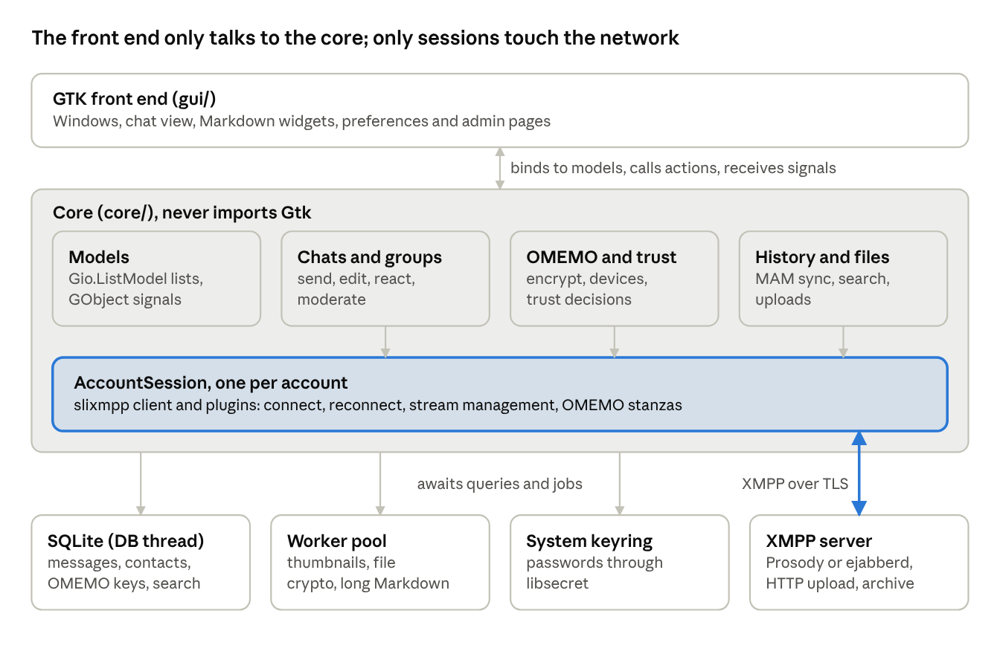
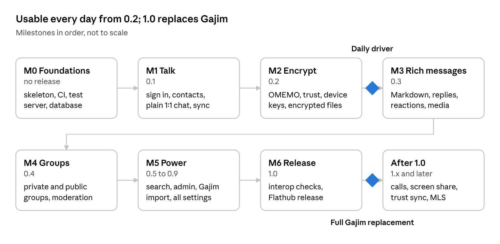

# Ward — Project Outline

Last updated: October 18, 2026

## Vision and principles

We build a complete Gajim replacement: an XMPP client for the Linux and BSD desktop, written in Python with GTK4 and libadwaita, encrypted with OMEMO by default, with full Markdown and deep settings. It is called **Ward** (app ID `io.github.smiley_mcsmiles.Ward`); the outline below still says "the app" in places.

**What "total replacement" means.** Anything a Gajim user does today, they can do here: multiple accounts, 1:1 and group chats, OMEMO with full key control, file transfer, history, search, service discovery, ad-hoc commands, server admin, XML console and calls. A Gajim user should be able to switch without losing anything they rely on.

**Principles**

- **Encrypted by default.** New 1:1 chats and private group chats start with OMEMO on. Unencrypted is always a visible, deliberate choice, never a silent fallback.
- **Trust you can understand.** Key states are shown in plain words and colours, not hex dumps. Experts still get full fingerprints, per-device control and export.
- **Modern GNOME look.** Follows the GNOME Human Interface Guidelines, adapts down to phone width (Librem 5, PinePhone, postmarketOS), light and dark styles, accent colours.
- **Rich, but not cluttered.** Many features and options, organised so a new user never sees an option they don't need. Advanced options live behind an "Advanced" page or expander.
- **Standards first.** Every feature uses a published XEP when one exists, so we interoperate with Gajim, Conversations, Dino, Monocles, Cheogram and Kaidan. Our own extensions (full Markdown, spaces) always fall back to something readable in other clients.
- **Same habits as Cascade.** A GTK-free core, a GTK front end on top, a strong test suite, small focused pull requests.

**Non-goals for 1.0**

- Not a Discord clone: no bots platform, no Nitro-style perks, no custom server software. We use stock Prosody and ejabberd.
- No Windows or macOS builds at first. The core stays portable, so they are possible later. Linux and the BSDs
  (FreeBSD, OpenBSD, NetBSD, DragonFly) are first-class: POSIX installer, no Linux-only APIs in the core.
- No protocol bridges (Matrix, Signal). Users can still reach them through existing XMPP gateways such as Slidge, which work like normal contacts.

## Status (v1.0.0)

Decisions taken: the name is **Ward**, the license is **MIT**, Ward runs natively on **GTK 4.12+ and libadwaita
1.4+** (Ubuntu 24.04's 1.5 included, newer widgets used when present), and the BSDs are supported alongside every
Linux family. OMEMO is integrated directly on python-omemo (no slixmpp-omemo, which is AGPL); legacy OMEMO's library
(oldmemo, AGPL) stays optional. OpenPGP (XEP-0373/0374) is in from the start, sharing keys with GPGMan.

**Done in v1.0.0** (M0 to most of M5, see Milestones):

- Foundations: GLib-driven asyncio loop (`ward/aio.py`, works on PyGObject 3.42+), typed settings schema that also
  generates Preferences, SQLite on its own thread with numbered migrations and backups, gettext.
- Accounts: sign in with per-step progress, account creation with the server's form and CAPTCHA, invite links,
  SRV for STARTTLS and direct TLS, certificate pinning, SOCKS5 / HTTP / Tor, stream management, CSI, keepalive,
  reconnect with backoff and on network or resume, several accounts, password change and account deletion.
- Messaging: carbons, MAM catch-up and scrollback with de-duplication, receipts, read markers synced (XEP-0490),
  typing, edits with history, retractions, replies with fallback, reactions, mentions, /me, drafts, requests from
  strangers, blocking and spam reports, retention, full-text search with filters.
- Encryption: OMEMO 2 with SCE and legacy OMEMO together, BTBV and manual trust, device pages with fingerprints,
  QR codes and verification links, new-device banners, per-message lock and trust, trust export/import, encrypted
  groups, encrypted files (aesgcm). OpenPGP with GPGMan's keyring, key generation and `.asc` import.
- Groups: private/public presets, joining, invites (direct and mediated), members panel, roles, affiliations,
  moderation (XEP-0425), room settings form, member and ban lists, bookmarks with autojoin, public channel search,
  room archives, self-ping.
- Files: HTTP upload over HTTPS with encryption, metadata stripping and resizing, thumbnails, auto-download limits,
  cache limits.
- Interface: everything above in an adaptive libadwaita window, Markdown rendered to native widgets, three message
  layouts, quick switcher, notifications with actions, background mode, tray icon, unread badge, xmpp: links,
  admin pages with a generic command view, XML console, service discovery browser, an in-app installer for the
  OMEMO libraries.
- Packaging: install.sh for every Linux family and the BSDs, package.sh for tarball, .deb, .rpm, Arch, Void and
  FreeBSD packages plus Alpine, Gentoo, FreeBSD/OpenBSD ports, NetBSD pkgsrc and Flatpak recipes.
- Tests: 90+ unit, integration (real Prosody, two slixmpp versions) and interface tests (Xvfb), CI for lint, mypy,
  distribution containers, BSD VMs, packages and Flatpak.

**Still to do after v1.0.0:** trust center across all contacts and bulk trust actions, "move this device", global
search window, chat export and full profile backup, Gajim import, folders, voice messages, link previews, swipe to
reply, PEP browser, GNOME Shell search provider, presence presets and auto-away, vCard4 profile fields, blocked
contacts page, accessibility pass with Orca, translations on Weblate, Hypothesis fuzzing, ejabberd in CI, and the
interoperability checklist. Calls stay after 1.0.

## Tech stack and architecture

One Python process runs everything on the GLib main loop, with asyncio running on top of it, so the XMPP library and GTK share one loop with no threading tricks. A GTK-free core does all the protocol, crypto and storage work. The GTK front end only displays and edits what the core holds.



The GTK front end binds to the core's models; only the per-account sessions open network connections, and the core reaches disk, CPU work and the keyring through awaited jobs.

| Layer | Choice | Why |
| --- | --- | --- |
| Language | Python 3.11+ | Same as Cascade; `TaskGroup`, `asyncio.timeout`, faster interpreter |
| Toolkit | GTK 4.12+, libadwaita 1.4+ via PyGObject 3.42+ | Our own asyncio loop on GLib (`ward/aio.py`) works on every supported PyGObject; newer libadwaita widgets are used when present |
| XMPP | slixmpp 1.8+ | asyncio-native, one plugin per XEP, documented; tested against 1.8 and the latest release |
| OMEMO | `omemo` + `twomemo` + optional `oldmemo` (Syndace) | OMEMO 2 for the future, legacy OMEMO 0.3 to talk to today's clients; our own thin integration instead of the AGPL slixmpp-omemo |
| OpenPGP | the `gpg` program (GnuPG), shared with GPGMan | XEP-0373/0374 for Gajim's OpenPGP users; no Python binding needed |
| Markdown | `markdown-it-py` + `mdit-py-plugins` + `linkify-it-py` | CommonMark-correct, gives a token tree we render into native widgets |
| Code and editor | GtkSourceView 5 + libspelling | Highlighted code blocks; Markdown-aware composer with spell check |
| Storage | SQLite (stdlib `sqlite3`) in WAL mode, FTS5 for search | No server, fast, one file per profile |
| Secrets | libsecret (`gi.repository.Secret`) | Passwords live in GNOME Keyring or KWallet; a mode-0600 file or "ask every time" where there is no keyring |
| HTTP | standard library `http.client` in the worker pool | File upload and download (XEP-0363), link previews; no extra dependency, goes through the account's proxy |
| Images | Pillow + Gdk.Texture | Thumbnails, EXIF/GPS stripping before upload |
| Crypto extras | `cryptography` | AES-256-GCM for encrypted files (XEP-0454); already pulled in by python-omemo |
| Calls (later) | GStreamer `webrtcbin`, libnice | The same approach Gajim and Dino use |

**Why slixmpp and not nbxmpp.** nbxmpp is Gajim's own library: GLib-native and tested against many servers, but tied to Gajim and lightly documented. slixmpp is asyncio-native with a plugin per XEP, and slixmpp-omemo already exists. Where slixmpp lacks a XEP (for example SASL2, Bind2, FAST), we write the plugin in our repo first and offer it upstream later.

**Threads.** The GLib/asyncio main thread does all networking and UI. A single database thread runs every SQLite query (callers `await` a future), so the UI never waits on disk. A small worker pool handles CPU work: image decoding, thumbnails, encrypting and decrypting large files, and Markdown parsing of very long messages.

**The core talks to the UI through GObject.** The core may import `GLib`, `Gio` and `GObject`, but never `Gtk` or `Adw`. It exposes `Gio.ListModel` lists (conversations, messages, contacts, devices) and GObject properties and signals. GTK list views bind to those models directly, and the whole core can be tested headless.

**One session per account.** Each account is an `AccountSession` wrapping a slixmpp `ClientXMPP` with its plugins, its OMEMO manager and its own reconnect logic. The app stays running in the background when the window is closed (`Gio.Application.hold`), so messages and notifications keep arriving.

**Same habits as Cascade.** Widgets are built in Python code (no Blueprint or `.ui` build step), with a hand-written `style.css`, an `install.sh` plus `.deb` / Arch packages, and a Flatpak manifest.

## Repository layout

The split follows the architecture: `core/` never imports Gtk, `gui/` never speaks XMPP directly.

```
ward/
  __main__.py, main.py   command line: --background, --quit, --check, --debug, xmpp: URIs
  aio.py                 asyncio event loop driven by the GLib main loop
  paths.py settings.py schema.py i18n.py log.py util.py
  deps.py                what is installed, install hints for 10 package managers
  extras.py              downloads the OMEMO libraries into Ward's own folder when the system lacks them
  core/
    core.py              Core: owns the database, the services and one AccountSession per account
    session.py           AccountSession: resolve, connect (proxies, TLS, pinning), SASL, SM, CSI, reconnect
    resolver.py proxy.py http.py secrets.py
    accounts.py roster.py requests.py names.py pep.py disco.py
    chats.py chat.py     chat list and messages: send, receive, correct, retract, react, reply, markers
    history.py           MAM catch-up and scrollback, de-duplication
    muc.py               groups: join, occupants, roles, moderation, settings, bookmarks, channel search
    files.py images.py   upload/download, aesgcm encryption, thumbnails, metadata stripping
    e2e.py               encryption policy: which method, and what the chat header says
    omemo/               python-omemo integration: service, storage, SCE, trust and its export
    pgp/                 OpenPGP: gnupg.py (the gpg program, GPGMan's settings), service.py (XEP-0373/0374)
    stanzas.py forms.py uri.py colors.py search.py notify.py admin.py register.py
    markup/              Markdown and XEP-0393 to our own render tree, emoji
    storage/             SQLite thread and numbered migrations
    models.py            GObject items and list models the interface binds to
  gui/
    app.py window.py     application, actions, notifications, badge, tray, links; the split-view window
    sidebar.py chatrow.py conversation.py message_row.py render.py composer.py members.py
    dialogs.py details.py trust.py welcome.py prefs.py forms_view.py admin.py tools.py
    compat.py            libadwaita 1.4 to 1.7+ from one code base
    style.css style.py icons/
data/                    .desktop, AppStream metainfo, icons, man page, shell completions
po/                      gettext template and translations
packaging/               mkdeb.py, mkarch.py, BSD packing lists, msgfmt.py, Flatpak manifest
tests/
  unit/                  no network
  integration/           against a throwaway Prosody (server.py), including the window under Xvfb
tools/                   run-prosody, screenshot.py, make_icons.py, flatpak_deps.py, update-pot.sh, release tools
install.sh  package.sh  README.md  ROADMAP.md  CHANGELOG.md
```

## Accounts and connection

The first run shows a welcome screen with three paths: sign in, create an account, or paste an invite link. Every account after that is managed from Preferences > Accounts.

**Onboarding**

- **Sign in:** address + password. We look up the server and show progress per step (finding server, securing connection, signing in), so errors say where it failed.
- **Create account:** pick a server from the [XMPP Providers](https://providers.xmpp.net) list (the same curated list Conversations and Kaidan use), filtered by free sign-up, upload size and message retention. Registration uses in-band registration (XEP-0077) and renders whatever form the server sends, including CAPTCHAs.
- **Invite link:** `xmpp:` invite URIs and invite web pages (XEP-0401, XEP-0445) create the account and add the inviter as a contact in one step (XEP-0379).

**Connecting**

- DNS SRV lookup for both STARTTLS and direct TLS (XEP-0368), with a manual host and port override.
- TLS 1.2 or newer only. If a certificate fails verification, we show its details and let the user pin it for that server, like Gajim does, with a clear warning.
- SASL: SCRAM-SHA-256-PLUS with channel binding first, then SCRAM-SHA-1, and PLAIN only over TLS and only if the user allows it. Downgrade protection with XEP-0474. Client certificates (SASL EXTERNAL) under Advanced.
- Later: SASL2, Bind2 and FAST (XEP-0388, XEP-0386, XEP-0484) for near-instant reconnects with a token instead of the password.

**Staying connected**

- Stream management (XEP-0198) resumes the session after short drops without losing messages.
- Reconnect with exponential backoff plus jitter, capped at 5 minutes, and immediately when `Gio.NetworkMonitor` reports the network is back or the machine wakes from sleep.
- Keepalive pings (XEP-0199) at a configurable interval.
- Client state indication (XEP-0352): when the window is hidden, the server holds back typing and presence noise to save battery and bandwidth.
- Each install gets a random resource name such as `app.k3f9`, editable under Advanced.

**Proxies and Tor**

- Follow the system proxy by default (`Gio.ProxyResolver`), or set SOCKS5 or HTTP CONNECT per account.
- A Tor preset (SOCKS5 on 127.0.0.1:9050) that also allows `.onion` servers and turns off link previews for that account.

**Multiple accounts**

- Unlimited accounts, each with a colour stripe and avatar in the sidebar's account switcher.
- The chat list shows one account or all accounts merged.
- Each account can be enabled, disabled, or set to connect on startup.

**Account management**

- Edit profile: avatar (XEP-0084, with vCard fallback XEP-0153), nickname (XEP-0172), vCard4 fields (XEP-0292).
- Change password and delete the account on the server (XEP-0077), with a typed confirmation.
- Server info page: software and version, supported features, upload limit, history support, contact addresses (XEP-0157).
- Presence: Available, Away, Busy (Do not disturb), Offline, plus a status message with saved presets. Auto-away after idle time where the desktop exposes it, otherwise based on window activity.

## Encryption, keys and trust

We speak both OMEMO versions at once, default to encryption everywhere it can work, and give users full control over every device key. This is the area where we aim to be clearly better than Gajim.

**Protocols**

- **OMEMO 2** (`urn:xmpp:omemo:2`) with Stanza Content Encryption (XEP-0420). It encrypts the whole message content: body, replies, reactions, corrections.
- **Legacy OMEMO 0.3** (`eu.siacs.conversations.axolotl`), which most of today's clients still use (Conversations, Gajim, Dino, Monocles). It encrypts only the message body.
- We publish device lists for both. For each contact we use OMEMO 2 when all their devices support it, otherwise legacy. python-omemo handles both at the same time.
- With legacy OMEMO, reactions, reply markers and typing indicators travel unencrypted. The chat header says so in plain words, and a setting can stop sending them in that case.
- OpenPGP for XMPP (XEP-0373/0374) is a possible later add-on for Gajim PGP users. Old PGP (XEP-0027) is not supported.

**Encryption policy** (per account, overridable per chat)

- **Always (recommended default):** never send unencrypted. If no device can receive, the composer explains why and offers fixes.
- **When available:** encrypt if the contact has OMEMO devices, otherwise send plain with a visible warning.
- **Off:** plain messages, shown with an open-lock icon.
- Group chats can be encrypted only when the room is members-only and non-anonymous. We turn it on automatically in such rooms and explain why it is unavailable in others.

**Trust models**

- **Blind trust before verification (default):** new devices are trusted until you verify one of that contact's devices. After that, new devices stay untrusted until you approve them. Same behaviour as Conversations.
- **Manual:** every new device waits for your decision.
- **Automatic trust management, later (XEP-0450):** verify once, and your own devices share trust decisions with each other securely, so a new laptop doesn't start from zero.

| State | Shown as | Effect |
| --- | --- | --- |
| Verified | Green shield with check | Encrypt to it; fingerprint confirmed in person or by QR |
| Trusted | Blue shield | Encrypt to it; trusted blindly or approved without verification |
| Undecided | Amber shield, "New device" | Not encrypted to until you decide; banner in the chat |
| Distrusted | Red shield, crossed out | Never encrypt to it; its messages are marked as suspicious |
| Inactive | Grey | Not in the contact's device list any more or unused for 90 days (configurable) |

**Verifying**

- Fingerprints shown in groups of 8 characters with consistent colours, the same format Conversations and Gajim use, so people can compare across apps.
- QR codes in the standard `xmpp:user@example.org?omemo-sid-<id>=<fingerprint>` form. We show ours and scan theirs with the camera (through the camera portal) or from an image file or the clipboard.
- Opening a verification link (`xmpp:` URI) marks exactly those devices as verified after a confirmation step.

**Your own devices** (Preferences > Encryption > This account's devices)

- List of all your devices: label (OMEMO 2 device labels), "this device" marker, fingerprint, trust state, last message seen from it.
- Remove stale devices from your published device list, one at a time or "remove all inactive".
- Rename this device's label; regenerate this device's identity (with a strong warning that contacts will see a new device).
- Signed prekey rotation interval and prekey count are set to safe defaults and editable under Advanced.

**Contact devices** (contact details > Encryption)

- Every device with fingerprint, OMEMO version, label, first seen, last used, and a trust dropdown.
- Bulk actions: "verify all with QR", "distrust all undecided".
- A banner in the chat when a contact adds a new device: *"Alex added a new device. It won't receive your messages until you decide."* with buttons Trust, Verify, Not now.

**Per-message indicators**

- A small lock on every message. Hover or tap shows: encryption used, sending device, its trust state at the time it arrived.
- An unencrypted message inside an encrypted chat is highlighted so it can't be missed.
- Messages we can't decrypt show a clear reason (no session, missing key, distrusted device) instead of raw text. Broken sessions repair themselves through python-omemo's session healing.

**Backup and moving devices**

- **Export trust list:** your verified and distrusted fingerprints in a passphrase-protected file (scrypt + AES-GCM). Safe to import on any new install.
- **Move this device:** exports the full identity and sessions to another computer, protected by passphrase, with a warning to use it on one machine only (two copies of one device break encryption).

**Privacy around encryption**

- Option to hide message text in notifications for encrypted chats (on by default).
- Images are stripped of EXIF and GPS data before upload (on by default).
- History is stored decrypted on disk, like in every other client; we recommend full-disk encryption. An optional database passphrase is listed under Risks.

## Messaging features

Every feature people expect from a modern messenger, each on a standard XEP so it works with other clients. Group chats get all of these too, plus the extras in the next section.

| Feature | Standard | How it looks and works |
| --- | --- | --- |
| Sync across your devices | XEP-0280 Carbons, XEP-0313 MAM | Messages sent from your phone appear here; history fills in after being offline |
| Delivery receipts | XEP-0184 | One check when the server has it, two when the contact's device received it |
| Read markers | XEP-0333, XEP-0490 | "Seen" under your last read message; reading on one device clears unread on all |
| Typing indicators | XEP-0085 | "Alex is typing…" in the header; can be turned off both ways |
| Edit | XEP-0308 | Up arrow edits your last message; "edited" label opens the edit history |
| Delete | XEP-0424 | "Delete for everyone" (sends a retraction) or "Delete for me" (local only) |
| Reply | XEP-0461 + XEP-0428 fallback | Quoted preview above your message; click jumps to the original; other clients see a normal quote |
| Reactions | XEP-0444 | Hover bar with your 6 quick reactions (configurable) plus the full emoji picker; who reacted on hover |
| Mentions | XEP-0372 references | `@` autocompletion; mentions highlighted and can notify even in muted chats |
| /me actions | XEP-0245 | Shown in italic as an action line |
| Stable message IDs | XEP-0359 | Every edit, reply, reaction and delete points at the right message, even across history sync |
| Stickers, later | XEP-0449 | Sticker packs shared as files |

**Conversation view**

- Messages from the same sender within 5 minutes are grouped under one name and avatar (setting: compact, cozy, or bubbles layout).
- Date separators, a "New messages" line at the first unread, and a jump-to-latest button with an unread count.
- Jump to a date, search within the chat, and scroll back infinitely through server history.
- Message menu: reply, react, edit, delete, copy text, copy as Markdown, quote, forward to another chat, save to "Saved messages", message details.
- Message details: sent, received and read times, encryption and device, message IDs, and the raw XML when developer mode is on.
- Slash commands with autocomplete: `/me`, `/nick`, `/topic`, `/invite`, `/kick`, `/ban`, `/role`, `/clear`, `/help`.

**Chat list**

- Sorted by last activity, with pinned chats on top, unread badges, last-message preview and typing indicator.
- Per chat: pin, mute (1 hour, 8 hours, 1 week, forever), mark as unread, archive, close.
- Filters: All, Unread, People, Groups, per account.
- Drafts are saved per chat and survive restarts; chats with drafts show "Draft:" in the preview.

**Strangers and spam**

- Messages from people not in your contacts land in a "Requests" section. Their images and links don't load until you accept.
- Accept, Block, or Block and report as spam (XEP-0191 blocking, XEP-0377 spam reporting) in one click.
- Option to only accept messages from contacts.

**Local history retention**

- Keep history forever (default), or delete local messages older than 30, 90 or 365 days, per account or per chat. This only affects this device; the server archive follows the server's own retention.

## Group chats

Group chats use standard multi-user chat (XEP-0045) with two clear presets, private groups (encrypted) and public channels, so users never have to understand room configuration to get it right.

**Creating and joining**

- **New private group:** members-only, non-anonymous, persistent, history archived. OMEMO is on from the start. Invite contacts in the same dialog.
- **New public channel:** open, members can't see each other's addresses, moderated optional, listed in the server's directory if the user wants.
- An "Advanced" button opens the full room configuration form, rendered as native preference rows.
- Join by address, by `xmpp:room@server?join` link or QR code, or by browsing: the server's room list (service discovery) and public channel search (XEP-0433, e.g. search.jabber.network).
- Bookmarks with autojoin synced across devices (XEP-0402, with XEP-0048 fallback for old servers).

**Inside a group**

- Members panel on the right (a bottom sheet on phones), grouped by role: owners, admins, moderators, members, visitors. Badges from XEP-0317 hats.
- Occupant IDs (XEP-0421) keep a person recognisable across nickname changes and are used for reactions and moderation.
- Room avatar (XEP-0486), topic in the header, member count.
- Join, leave and nickname-change lines are collapsed into one summary line ("3 people joined"), or hidden entirely by setting.
- Private messages to a member, with a clear warning when they can't be encrypted.
- Self-ping (XEP-0410) detects when the server silently dropped us from a room and rejoins.
- History catch-up from the room's archive (MAM) when it supports it, otherwise the server's join history.

**Moderation** (shown only to people who have the rights)

- From a message or member: delete message for everyone (XEP-0425), kick, ban with reason, mute (take voice), make member, admin or owner.
- Room settings pages: name, description, avatar, topic, password, who can invite, who can see addresses, moderation, history, member list and ban list editors.
- Voice requests in moderated rooms appear as approve or deny cards.
- Invites: direct invites (XEP-0249) to contacts, invite links and QR codes.

**Notifications per group**

- All messages, mentions and replies only (default for groups over 20 members), or nothing.
- Custom highlight words per account (your name, project names).

**Folders (optional)**

- Users can group chats into named folders in the sidebar (Family, Work, Gaming), shown collapsed or expanded.
- Folders sync between your devices in private storage on your server (PEP), so other clients ignore them safely.
- This is the light version of the "servers and channels" idea: organisation without inventing a new protocol.

## Markdown and message rendering

Messages are written and sent as Markdown text and rendered into native GTK widgets, never a web view. Other clients see readable plain text, and messages from them are styled with the XMPP standard rules so nothing looks broken.

**What we render**

| Syntax | Example | Rendered as |
| --- | --- | --- |
| Bold, italic, strikethrough | `**bold**`, `*italic*`, `~~gone~~` | Pango text styles |
| Inline code | `` `code` `` | Monospace with a tinted background |
| Code block | ```` ```python ```` | Syntax-highlighted block, language label, copy button |
| Block quote | `> quoted` | Indented with an accent bar, nests |
| Lists and task lists | `- item`, `1. item`, `- [x] done` | Real bullets, numbers and check marks (read-only) |
| Tables | pipe tables | A grid that scrolls sideways when wide |
| Headings | `# Title` | Bold, sizes capped so one message can't shout |
| Links | `[text](url)`, bare URLs | Clickable; warns when link text and target differ |
| Spoilers | `\|\|secret\|\|` | Blurred until clicked |
| Mentions | `@Alex` | Highlighted name chip |
| Emoji shortcodes | `:tada:` | Converted to the emoji while typing |
| Horizontal rule | `---` | A thin separator |

Raw HTML is never rendered (shown as text), and remote images in Markdown are shown as links, not loaded, so nobody can track you by sending an image link. Math (LaTeX) rendering is an optional later add-on.

**On the wire**

- The message body is always the Markdown source, which reads fine as plain text in any client.
- We add an empty `<markdown/>` flag element (our own namespace, advertised through service discovery) so our clients know to render full Markdown.
- The flag carries no content on purpose: legacy OMEMO only encrypts the body, so any extra element would travel unencrypted.
- Messages without the flag are styled with Message Styling (XEP-0393), the rules Conversations, Dino and Gajim use. This matters because `*text*` means bold in XEP-0393 but italic in Markdown.
- Setting: "Render Markdown in messages from other apps" (off by default) for people who know their contacts write Markdown.

**Rendering pipeline**

1. markdown-it-py parses the text with the CommonMark rules plus tables, strikethrough, task lists, linkify, and our plugins for spoilers, mentions and emoji. HTML is disabled at the parser.
2. The tokens become a small tree of our own types (paragraph, code block, quote, list, table, rule) so the renderer doesn't depend on markdown-it internals.
3. The tree becomes widgets: text runs as escaped Pango markup in wrapping, selectable `Gtk.Label`s; code blocks as read-only `GtkSource.View`; tables as `Gtk.Grid` in a horizontal scroller; quotes and spoilers as boxes styled in `style.css`.
4. Parsed trees are cached per message ID (LRU), and messages over 4 KB are parsed on the worker pool, so scrolling stays smooth.

**Message list performance**

- `Gtk.ListView` with recycled rows, bound to the core's message model, so a chat with 100,000 messages scrolls like one with 100.
- Very long messages collapse after 25 lines with "Show more".
- Messages with only 1 to 3 emoji are shown large.
- GTK can't select text across separate rows, so a "Select messages" mode copies several messages at once, with names and times, as text or Markdown.

**The composer**

- A `GtkSource.View` with Markdown highlighting, so `**bold**` looks bold while you type.
- Optional formatting toolbar: bold, italic, strikethrough, code, quote, link, list, spoiler. Shortcuts Ctrl+B, Ctrl+I, Ctrl+E, Ctrl+K, Ctrl+Shift+X.
- Enter sends and Shift+Enter adds a new line, or the reverse (setting).
- Preview button shows the rendered message above the composer before sending.
- Spell check with libspelling, language picker per chat.
- Emoji picker button and `:` autocompletion; `@` mention autocompletion in groups.
- Paste or drop images and files to attach them; an edit banner shows when you are editing a message.

## Files, media and previews

Files go through the server's HTTP upload service (XEP-0363) and are encrypted with AES-256-GCM in encrypted chats (XEP-0454). Images, video, audio and voice messages play inline.

**Sending**

- Attach button (file chooser portal), drag and drop, paste from clipboard, or the screenshot portal. Several files at once, each with progress, cancel and retry.
- The server's size limit is checked before uploading, with a clear message when a file is too big.
- Image quality setting: Original, Balanced (longest side 2560 px, re-encoded at quality 85), or Small (1280 px). EXIF and GPS data stripped unless the user turns it off.
- Each file is announced with stateless file sharing and file metadata (XEP-0447, XEP-0446): name, size, type, dimensions, hash and a small thumbnail (XEP-0264). An out-of-band URL (XEP-0066) goes along so older clients still get a link.

**Encryption**

- In encrypted chats the file is encrypted before upload; the key and IV travel inside the encrypted message as an `aesgcm://` link, the format Conversations, Gajim and Dino use.
- We accept both 12-byte and 16-byte IVs for compatibility. Encryption and decryption stream through the worker pool, so a 1 GB file doesn't freeze anything or fill memory.

**Receiving**

- Auto-download: images and voice messages up to 10 MB from contacts (configurable), nothing automatic from strangers, everything else on click.
- Downloads go to a cache folder with a size limit; "Save as" uses the portal. Preferences > Storage shows usage per account and cleans up old files.

**Viewing**

- Images as thumbnails in the message, several images as a grid. Click opens a full viewer: zoom, pan, previous and next image in the chat, save, copy, open with another app.
- Animated GIF and WebP play inline (can be set to play on hover only).
- Video and audio play inline through `Gtk.Video` (GStreamer), with a poster frame.
- Other files show as a card with icon, name, size and an open button.

**Voice messages**

- Record button in the composer: click to start, click to stop, preview before sending, or hold to record and release to send.
- Recorded as Opus with a waveform preview. Voice messages from other apps (Ogg/Opus, M4A/AAC) play with the same player, with playback speed 1x, 1.5x, 2x.

**Link previews**

- Title, description and image from a page's Open Graph tags, shown as a card under the message.
- Off for strangers and for Tor accounts. Fetching reveals your IP address to the website, so the setting explains it: Off, Only from contacts (default), Always.
- Strict limits: 5-second timeout, at most 1 MB read, no scripts, images re-encoded before display.

**Special links**

- `xmpp:` links become cards with "Add contact" or "Join group".
- `geo:` locations become a card with the coordinates and "Open in Maps". No map tiles load unless the user enables them.

## Contacts, presence and roster

Contacts get their own page next to Chats in the sidebar, with groups, status and full details. Subscription jargon is translated into plain language everywhere.

**Contact list**

- Roster groups as collapsible sections; search; sort by name or by status; "Show offline contacts" toggle.
- Each row: avatar with status dot, name, status message, and a small icon for gateway contacts.
- Roster versioning (RFC 6121) so large contact lists load instantly on reconnect.

**Adding people**

- By address, by scanning a QR code, or by opening an `xmpp:` link. Optional intro message and groups.
- Our own QR code and share link on the profile page, so people can add you in one scan.

**Requests and sharing status**

- Incoming requests appear in the Requests section with Accept, Decline and Block.
- Subscription states shown in plain words: "You both see each other's status", "Alex sees your status, you don't see theirs", and so on, with a toggle for each direction.

**Contact details**

- Avatar, name (with a local nickname you can set), address, status, last seen (XEP-0319, XEP-0012).
- Their devices and apps (XEP-0092) and local time (XEP-0202).
- Profile information from vCard4 (XEP-0292), falling back to the old vCard format.
- Tabs: Encryption (device keys, see above), Media and Files shared in the chat, Notifications, and actions Block, Remove contact, Clear history.

**Avatars and colours**

- Real avatars from XEP-0084 and vCard, cached on disk.
- Placeholders with initials, and nickname colours, generated with XEP-0392 so a person has the same colour in our app as in Conversations and Dino.

**Blocking and privacy**

- Blocked contacts page (XEP-0191) with unblock.
- Options to not answer software version, local time and last activity questions.

**Gateways**

- Service discovery lists gateways (XEP-0100), registration uses their forms, and gateway contacts work like any other contact. This covers bridges such as Slidge to other networks.

## Desktop integration

The app behaves like a native GNOME app on any desktop: portal-based notifications and file access, background running, adaptive layout down to phone size, and full keyboard control.

**Notifications**

- `Gio.Notification` through the notification portal, one notification per chat that updates instead of piling up.
- Actions: Open chat, Mark as read, Mute for 1 hour.
- Sounds per event (message, mention, request, call), each with its own file or none.
- Content options: show sender and text, sender only, or just "New message".

**Running in the background**

- Closing the window keeps the app connected (setting), so messages and notifications still arrive.
- The background portal asks for permission to run in the background and to start at login.
- Unread count on the dock icon through the Unity LauncherEntry D-Bus API (Dash to Dock, KDE Plasma, Plank).
- Optional tray icon for KDE, Xfce and Cinnamon users via StatusNotifierItem over D-Bus. Off by default on GNOME, which has no tray.

**Opening things**

- Registered handler for `xmpp:` links, so clicking one in a browser opens the right chat, contact or group.
- Single instance: a second launch brings the window forward. Command line options `--open <uri>`, `--background`, `--quit`.
- GNOME Shell search provider for contacts and chat names, off by default for privacy.

**Adaptive layout**

- `Adw.NavigationSplitView`: sidebar and chat side by side on wide windows, one at a time under 600 px.
- The members panel and contact details become bottom sheets on narrow screens.
- Touch: swipe a message to reply, long-press for the message menu.

**Keyboard shortcuts**

| Shortcut | Action |
| --- | --- |
| Ctrl+K | Quick switcher: jump to any chat by name |
| Ctrl+N | New chat |
| Ctrl+F / Ctrl+Shift+F | Search in this chat / search all history |
| Alt+Up / Alt+Down | Previous / next chat |
| Ctrl+Tab | Next chat with unread messages |
| Up (in empty composer) | Edit your last message |
| Ctrl+W | Close chat |
| Ctrl+, | Preferences |
| Ctrl+? | Shortcuts window |

**Portals and sandbox**

- File chooser, camera (QR scanning), screenshot, background, open URI, notifications and secrets all go through portals.
- The Flatpak asks only for network, display, sound and the microphone when recording; no access to the home folder.

## Storage, history and search

One SQLite database per profile holds messages, contacts and OMEMO state; files and avatars live in the cache folder; app-wide settings are a JSON file like Cascade's. Server history is pulled in incrementally and de-duplicated by message ID.

**Where things live**

- `~/.local/share/<app>/app.db` — messages, contacts, chats, OMEMO keys and trust, per-account and per-chat settings.
- `~/.cache/<app>/` — downloaded files, thumbnails, avatars, link previews; size-limited and safe to delete.
- `~/.config/<app>/settings.json` — app-wide preferences with a typed schema and change signals.
- Passwords only in the system keyring (libsecret).

**Main tables**

| Table | Holds | Key columns |
| --- | --- | --- |
| `accounts` | One row per account | jid, resource, enabled, colour, options JSON |
| `chats` | 1:1 chats and groups | account, jid, type, pinned, muted\_until, archived, draft, last\_read\_id |
| `messages` | Every message | chat, stanza\_id, origin\_id, sender, direction, timestamp, body, is\_markdown, encryption, sender\_device, trust\_at\_receipt, correction\_of, retracted, reply\_to |
| `messages_fts` | Full-text index | FTS5 over message text with Markdown stripped |
| `reactions` | Reactions per message | message, sender, emoji set, timestamp |
| `attachments` | Files in messages | message, url, aesgcm key and IV, mime, size, sha256, local path, thumbnail |
| `receipts` | Delivery and read state | message, recipient, delivered\_at, displayed\_at |
| `contacts` | Roster | account, jid, name, local nickname, groups, subscription, avatar hash |
| `mam_state` | Sync position per archive | account, archive jid, last archive id, complete flag |
| `omemo_*` | python-omemo storage | identities, devices, sessions, prekeys, trust |
| `schema_version` | Migration level | version, applied\_at |

**Migrations** are numbered SQL files run in order at startup. The database is copied to a backup file before any migration, and kept until the next successful start.

**History sync (MAM, XEP-0313)**

- On reconnect, one query to your own archive fetches every 1:1 message since the last known archive ID, 100 per page, until complete.
- Each group is caught up from its own archive when joined.
- New accounts load the last 7 days; older messages load as you scroll up.
- Duplicates are dropped by stanza ID and origin ID (XEP-0359). Edits, deletes and reactions that arrive before their target are held and applied when it shows up.
- Server history preference (XEP-0441): keep everything, only with contacts, or nothing.

**Search**

- Global search (Ctrl+Shift+F) and in-chat search (Ctrl+F) over everything stored locally, using FTS5.
- Filters typed or picked from chips: `from:alex`, `in:family`, `has:file`, `has:link`, `before:2026-01-01`, `after:`.
- Results grouped by chat with highlighted snippets; clicking one opens the chat at that message with context around it.

**Export and import**

- Export a chat as Markdown, HTML, plain text or JSON.
- Full profile backup: database, settings and keys in one passphrase-protected archive; restore on a new machine.
- **Import from Gajim:** accounts, chat history, bookmarks and OMEMO trust decisions. Importing Gajim's OMEMO identity (so contacts don't see a new device) is marked experimental and requires that Gajim is no longer used.

## Server administration and power tools

If your account is an admin on its server, a "Server" section appears in the sidebar automatically, with native pages built on the standard admin commands (XEP-0050, XEP-0133). Anything we haven't designed a page for still works through a generic command view.

**How admin rights are detected**

- After login we list the server's commands (service discovery on the `http://jabber.org/protocol/commands` node).
- If XEP-0133 admin commands such as `http://jabber.org/protocol/admin#add-user` are offered to us, the Server section appears for that account. Regular users never see it.
- Each page only shows the actions the server actually offers, so Prosody and ejabberd both work without special cases.

**Server pages**

| Page | What you can do | Commands used |
| --- | --- | --- |
| Overview | Software and version, uptime, online and registered user counts | XEP-0092, `#get-online-users-num`, `#get-registered-users-num`, Prosody uptime |
| Users | Search users, see who's online, add, delete, disable, re-enable, reset password, end sessions | `#get-registered-users-list`, `#add-user`, `#delete-user`, `#disable-user`, `#reenable-user`, `#change-user-password`, `#end-user-session` |
| Invites | Create account or contact invite links with expiry; copy, share or show as QR | Prosody `mod_invites` commands (XEP-0401 links) |
| Announcements | Message all online users; set, edit or clear the message of the day | `#announce`, `#set-motd`, `#edit-motd`, `#delete-motd` |
| Maintenance | Reload modules, restart or shut down with a delay and warning message | `#restart`, `#shutdown`, Prosody module reload |
| All commands | Every command the server offers, rendered as native forms | XEP-0050 multi-step forms |

**Generic command view**

- Renders any XEP-0004 data form as libadwaita rows: text, password, multi-line, single and multiple choice, lists of addresses, booleans, hidden fields.
- Supports multi-step commands with Back, Next, Complete and Cancel, and shows the server's notes and errors.
- Works on any address, not just your server: bots, gateways and services that offer commands.

**Optional admin API**

- For deeper management, connect Prosody's `mod_http_admin_api` (what Snikket uses) or ejabberd's `mod_http_api` with a token. This adds groups, richer user details and invite lists.
- Everything outside the chat service (config files, TLS certificates, logs, OS updates) stays out of scope; that's SSH work.

**Power tools** (Preferences > Advanced > Developer tools)

- **XML console:** live log of every stanza per account, with filters by type and direction, syntax highlighting, pause, search, and a box to send raw XML. Passwords and keys are masked.
- **Service discovery browser:** a tree of servers, components and nodes with their identities and features; join rooms, register with gateways and run commands from it.
- **PEP browser:** view and delete items in your own personal storage nodes, which helps when debugging OMEMO device lists or avatars.

## Preferences

Preferences is an `Adw.PreferencesDialog` with 9 pages, each searchable. Defaults are chosen so most people never need to open it; every option below is one row. Per-chat overrides (notifications, encryption, spell-check language) live in each chat's details, not here.

**General**

| Option | Choices | Default |
| --- | --- | --- |
| Run in background when the window is closed | on / off | on |
| Start at login | on / off | off |
| Tray icon | automatic / always / never | automatic (off on GNOME) |
| Confirm before quitting | on / off | off |
| Open `xmpp:` links with this app | on / off | on |

**Appearance**

| Option | Choices | Default |
| --- | --- | --- |
| Style | follow system / light / dark | follow system |
| Accent colour | follow system / 9 colours | follow system |
| Text size | 80% to 200% in 10% steps (also Ctrl+Plus / Ctrl+Minus) | 100% |
| Message font | system font / any installed font | system font |
| Code font | system monospace / any monospace font | system monospace |
| Line spacing | compact / normal / relaxed | normal |
| Message layout | bubbles / cozy (names and avatars) / compact (IRC-like) | cozy |
| Avatars in chats | always / groups only / never | always |
| Avatar shape | circle / rounded square | circle |
| Coloured nicknames | on / off | on |
| Timestamps | always / on hover / off | on hover |
| Time format | follow system / 12-hour / 24-hour, show seconds | follow system |
| Code block colour scheme | automatic light/dark pair / any GtkSourceView scheme | automatic |
| Large emoji in emoji-only messages | on / off | on |
| Chat list density | comfortable / compact | comfortable |
| Message previews in chat list | on / off | on |

**Chats and messages**

| Option | Choices | Default |
| --- | --- | --- |
| Send with | Enter / Ctrl+Enter | Enter |
| Formatting toolbar | on / off | off |
| Render Markdown from other apps | on / off | off |
| Convert `:shortcodes:` to emoji | on / off | on |
| Convert ASCII smileys like :) | on / off | off |
| Quick reactions | pick 6 emoji | 👍 ❤️ 😂 😮 😢 🎉 |
| Send typing indicators / show them | on / off each | on |
| Send read markers / delivery receipts | on / off each | on |
| Join and leave lines in groups | summary / every line / hidden | summary |
| Collapse long messages after | 10 to 100 lines, or never | 25 |
| Link previews | off / only from contacts / always | only from contacts |
| Play animated images | always / on hover / never | always |
| Confirm "Delete for everyone" | on / off | on |
| Spell check, languages | on / off, list of installed dictionaries | on, system language |

**Notifications**

| Option | Choices | Default |
| --- | --- | --- |
| Notifications | on / off | on |
| Show in notification | sender and text / sender only / nothing | sender and text |
| Hide text for encrypted chats | on / off | on |
| Group chats | all messages / mentions and replies / none | mentions and replies |
| Highlight words | list of words | your nickname |
| Sounds | on / off, a sound per event | on, default sounds |
| Quiet hours | off / a daily time range | off |
| Unread count on the dock icon | on / off | on |

**Accounts** (a sub-page per account)

| Group | Options |
| --- | --- |
| Profile | avatar, nickname, vCard fields, QR code and share link |
| Connection | enabled, connect on startup, host and port override, direct TLS, resource, priority, proxy (system / none / SOCKS5 / HTTP / Tor) |
| Security | change password, allowed sign-in methods, pinned certificates, client certificate |
| Privacy | answer version, time and last-activity queries (off by default), send idle time |
| History | server archive policy, how many days to load on first sync (7), local retention (forever) |
| Files | image upload quality (Balanced), auto-download limit (10 MB), allow uploads larger than 100 MB |
| Danger zone | remove from this app, delete account on the server |

**Encryption and privacy**

| Option | Choices | Default |
| --- | --- | --- |
| Default encryption | always / when available / off | always |
| Trust new devices | blind trust before verification / ask every time | blind trust before verification |
| Tell me about new devices | chat banner / banner and notification | chat banner |
| Mark devices inactive after | 30 / 90 / 180 days / never | 90 days |
| Allow legacy OMEMO (0.3) | on / off | on |
| Limit unencrypted extras with legacy OMEMO | on / off (no reactions or typing sent) | off |
| Strip image location and camera data | on / off | on |
| Messages from strangers | Requests folder / block / allow | Requests folder |
| Load images and previews from strangers | on / off | off |
| Trust center | page listing every undecided or distrusted device across all contacts, with bulk actions | — |
| Own devices | link to each account's device list | — |
| Export / import trust list, move this device | buttons | — |

**Storage**

| Option | Choices | Default |
| --- | --- | --- |
| Cache usage | per account, with "Clear" | — |
| Cache size limit | 250 MB / 1 GB / 5 GB / unlimited | 1 GB |
| Delete downloaded files after | 30 / 90 / 365 days / never | never |
| Database size, "Compact database" | button | — |
| Back up profile, restore profile, import from Gajim | buttons | — |

**Audio and video** (arrives with calls)

| Option | Choices | Default |
| --- | --- | --- |
| Microphone, speaker, camera | device pickers with a test | system default |
| Echo cancellation, noise suppression | on / off each | on |
| Voice message recording quality | standard / high | standard |

**Advanced**

| Option | Choices | Default |
| --- | --- | --- |
| Developer tools (XML console, discovery, PEP browser) | on / off | off |
| Debug log | off / normal / verbose, "Open log folder" | off |
| Keepalive ping interval | 30 s to 10 min | 60 s |
| Reconnect delay cap | 1 to 30 min | 5 min |
| Prefer IPv6 | automatic / prefer IPv4 / prefer IPv6 | automatic |
| OMEMO prekey count, signed prekey rotation | numbers | python-omemo defaults |
| Reset all preferences | button | — |

Keyboard shortcuts are shown in the shortcuts window (Ctrl+?). Customising them is a later addition.

## Calls

One-to-one audio and video calls are in, built on Jingle and GStreamer's `webrtcbin`, translating Jingle to SDP the way Conversations does, and tested against offers shaped like Conversations' own. Still to come: call keys verified through OMEMO, screen sharing, choosing devices, the camera portal, a picture-in-picture view, and group calls.

**Protocol**

- Jingle sessions (XEP-0166) with RTP audio and video (XEP-0167), ICE-UDP (XEP-0176) and DTLS-SRTP encryption (XEP-0320).
- Jingle Message Initiation (XEP-0353) rings all your devices; answering on one stops the others.
- STUN and TURN servers discovered from your server (XEP-0215), e.g. Prosody with coturn.
- Call keys verified through OMEMO (XEP-0396), so a call with a verified contact shows as verified, as in Conversations.

**Media**

- Opus audio; VP8 video, with H.264 where available.
- Microphone and speakers through PipeWire, the camera through the camera portal, screen sharing through the ScreenCast portal.
- Echo cancellation and noise suppression from GStreamer's WebRTC audio processing.

**Interface**

- Call buttons in the chat header; an incoming call notification with ringtone, Accept and Decline.
- Call window with mute, camera on/off, screen share, speaker choice and hang up; a small picture-in-picture view when you switch to another chat.
- Call history lines in the chat (missed, duration).

**Group calls, later:** call invites in groups (XEP-0482) and small mesh calls of up to 4 people, or handing off to a Jitsi Meet link. Decided after 1:1 calls are solid.

## Accessibility, theming and translations

Everything works with the keyboard and the Orca screen reader, follows the system's contrast and motion settings, and is translatable from the first release.

**Accessibility**

- Every custom widget sets its accessible role and label. A message row reads as "Alex, 10:42, encrypted, verified device: message text".
- Full keyboard navigation through the chat list, messages (arrow keys between messages, Enter for the message menu) and every dialog.
- Follows the system's high-contrast and reduced-motion settings; text size scales up to 200% without clipping.
- Colour is never the only signal: trust states differ in icon shape and text, not just colour.
- Nickname colours (XEP-0392) are adjusted for enough contrast on both light and dark backgrounds.
- An Orca pass is part of the checklist for every release.

**Theming**

- Standard libadwaita styling with light, dark and accent colours, so system themes apply.
- For power users: an optional `custom.css` in the config folder, loaded last (Advanced page).

**Translations**

- gettext with a `po/` folder from the first commit; every user-visible string is marked.
- Hosted translation through Weblate once the strings settle (around 0.4).
- Right-to-left layouts tested; dates, times and numbers formatted for the user's locale.

## Testing and CI

Every pull request runs lint, type checks, unit tests and real end-to-end tests against a Prosody server in a container, so encryption and sync are proven on every change, not by hand.

**Unit tests (pytest, no network)**

- Markdown: golden tests from input text to our render tree, plus XEP-0393 styling cases from the spec.
- Trust engine: every state change (new device, verify, distrust, inactive) under both trust models.
- Database: every migration applied from an empty database and from each older version.
- History sync: de-duplication, out-of-order edits, deletes and reactions.
- Parsers: `xmpp:` URIs, data forms, `aesgcm://` links, search filter syntax.
- Fuzzing with Hypothesis on Markdown and incoming stanzas: bad input must never crash the app.

**Integration tests (real server)**

- `tools/run-prosody` starts a throwaway Prosody (no root, no container needed) with test users, group chat, file upload (`mod_http_file_share`) over HTTPS, archive, invites and admin rights; the integration tests use the same server.
- Tests run two or three real `AccountSession`s against it: OMEMO 2 and legacy messages both ways, encrypted group chat, encrypted file round trip, edits, deletes, reactions, history catch-up after being offline, admin commands and invites.
- A weekly job repeats the suite against ejabberd.

**Interface tests**

- Headless smoke tests under Xvfb: open every window, dialog and preferences page and check for warnings.
- `tools/screenshots` regenerates the README screenshots, as in Cascade.

**Interoperability checklist** (by hand, before each release)

- Conversations and Monocles (Android), Gajim and Dino (desktop), Kaidan, Cheogram: messages, encryption both versions, files, reactions, replies, edits, calls once they exist.

**CI on GitHub Actions**

- `ruff` lint and format check, `mypy` on `core/`, pytest on Python 3.11, 3.12 and 3.13, integration tests with Prosody as a service container, and a Flatpak build.
- Coverage target: 80% for `core/`.

## Packaging and distribution

Ward runs on as many systems as possible: every major Linux family and the BSDs, from system packages, a portable
installer or the Flatpak. Flathub follows at 1.0.

| Channel | Systems | Built by |
| --- | --- | --- |
| Flatpak | any Linux | `packaging/flatpak/` manifest, Python dependencies pinned with hashes by `tools/flatpak_deps.py` |
| `.deb` | Debian 13+, Ubuntu 24.04+, Mint, Pop!_OS | `package.sh` with `packaging/mkdeb.py` (builds on any distribution) |
| `.rpm` | Fedora, RHEL, openSUSE | `package.sh` with rpmbuild, or `--container` |
| `.pkg.tar.xz` + PKGBUILD | Arch, Manjaro, EndeavourOS | `package.sh` with `packaging/mkarch.py` (builds on any distribution) |
| `.xbps` + template | Void | `package.sh` with xbps-create |
| APKBUILD | Alpine, postmarketOS | recipe |
| ebuild | Gentoo | recipe |
| port / `.pkg` | FreeBSD, DragonFly | recipe with a generated pkg-plist; a `.pkg` when built on FreeBSD |
| port | OpenBSD | recipe with a generated PLIST |
| pkgsrc | NetBSD (and pkgsrc elsewhere) | recipe with a generated PLIST |
| tarball + `install.sh` | anything with Python 3.11, GTK 4.12 and libadwaita 1.4 | POSIX sh; `--install-deps` for apt, dnf, zypper, pacman, xbps, apk, emerge, pkg, pkg_add and pkgin |

- **Libraries no distribution ships** (the OMEMO stack): packages depend only on what distributions do ship; Ward
  downloads the rest with pip into its own folder when the user first needs encryption (or `install.sh --vendor` does
  it for all users). The Flatpak includes everything.
- **Releases:** `major.minor.patch`, CHANGELOG.md, a tag runs the release workflow (every package, the Flatpak bundle
  and SHA256SUMS), AppStream metadata with release notes and screenshots.

## Milestones

Seven milestones, each a series of small pull requests that leave the app working at every step. The app becomes usable for daily chats at 0.2 (encrypted 1:1), and 1.0 is the full Gajim replacement minus calls.



The first gate comes after encryption (0.2), when we can use it for real chats; the second is 1.0, when nothing Gajim users rely on is missing except calls.

**M0 — Foundations** (done)

- Repository skeleton, `ROADMAP.md` (this outline), CI with lint, types and tests.
- `tools/run-prosody` test server; settings module; database layer with migrations.
- Empty app shell: window, sidebar, preferences dialog frame, about dialog.

**M1 — Talk (0.1)** (done)

- Sign in, reconnect, stream management; contact list and requests.
- Plain 1:1 chat with carbons, history sync, receipts, typing, chat list, drafts, notifications, background running.

**M2 — Encrypt (0.2)** (done except the trust center)

- OMEMO 2 and legacy, encryption policy, trust models, device lists, new-device banners.
- Fingerprint and QR verification, Trust center, per-message lock indicators.
- Encrypted file upload and download (basic).

**M3 — Rich messages (0.3)** (done except voice messages and link previews)

- Markdown renderer and composer, Message Styling for other clients.
- Replies, reactions, edits, deletes, mentions, emoji, media viewer, voice messages, link previews.

**M4 — Groups (0.4)** (done except folders)

- Group chats with private and public presets, encrypted groups, members panel, moderation, room settings, bookmarks, public channel search, folders.

**M5 — Power (0.5 to 0.9)** (search, admin pages, XML console, discovery and every preferences page done)

- Full-text search, export, backup and restore, Gajim import.
- Server admin pages, XML console, discovery and PEP browsers.
- Every preferences page complete, accessibility pass, translations open on Weblate.

**M6 — 1.0**

- Interop checklist passed with all listed clients, bug-fix rounds, documentation, Flathub release.

**After 1.0**

- 1:1 audio and video calls, screen sharing (1.x).
- Automatic trust management (XEP-0450), SASL2 and FAST fast reconnects, stickers, OpenPGP add-on, group calls, and MLS group encryption once it is standardised for XMPP.

## Risks and open questions

The biggest risks are in libraries we depend on, not in the GTK work; each has a fallback that keeps the plan intact.

| Risk | Impact | Mitigation |
| --- | --- | --- |
| The OMEMO libraries have essentially one maintainer | Bugs or slow fixes in our most critical code | Pin versions, keep our own integration layer thin, contribute fixes upstream, integration tests catch regressions |
| slixmpp lacks some XEPs or has bugs | Features take longer | Our own plugins in `xmpp/plugins/`, offered upstream |
| PyGObject's asyncio support is new, and Python is deprecating event loop policies (3.14, removal planned for 3.16) | Startup code may need changes on newer Python | Isolate loop setup in `__main__.py`; follow PyGObject's replacement API; a small GLib-asyncio bridge as last resort |
| Our Markdown flag element is non-standard | Other clients show Markdown as plain text | It degrades to readable text by design; propose it as a XEP once it has proved itself |
| Large public groups flood presence | Python can lag with thousands of members | Batch model updates, throttle presence handling, load member lists lazily |
| OMEMO in groups costs one encryption per device | Slow sends in big encrypted groups | Fine below about 100 members; show a note above that |
| Legacy OMEMO leaks metadata (reactions, replies, typing) | Less privacy with older clients | Clear notice in the chat header; optional setting to hold back extras |
| Calls are a large, separate project | Could delay 1.0 | Calls are explicitly after 1.0 |

**Open questions**

- [x] App name and app ID: **Ward**, `io.github.smiley_mcsmiles.Ward`.
- [x] License: **MIT**, like Cascade. All code is written fresh; nothing is copied from Gajim. The optional legacy
  OMEMO library (oldmemo) is AGPL-3.0, so Ward never bundles it except where the user asks for it (the Flatpak and
  `install.sh --vendor` say so).
- [x] Minimum distribution: **GTK 4.12 and libadwaita 1.4** natively (Ubuntu 24.04, Debian 13, Fedora 40, the BSDs'
  current ports), using newer widgets (Adw.Dialog, AlertDialog, Spinner, ButtonRow, WrapBox) when they are there.
- [ ] Should the local database support an optional passphrase (SQLCipher), at the cost of an extra dependency and
  typing it at every start?
- [ ] Officially support ejabberd as well as Prosody for admin features, or Prosody first? (Admin pages are generic
  ad-hoc command forms, so ejabberd works; CI tests Prosody so far.)

## What I need from you next

- [ ] Try it with your own server and an admin account (the Server pages and invites are tested against Prosody only).
- [ ] Decide on the database passphrase question and on ejabberd in CI.
- [ ] Create the first release tag (`v1.0.0`); the release workflow builds every package and the Flatpak bundle.
